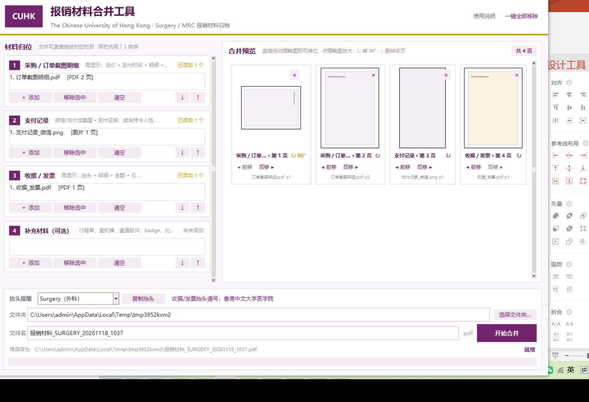

# Reimburse Merger · 报销材料合并工具

把一次报销的 3–4 份材料（订单截图 / 支付记录 / 收据发票 / 补充材料）按顺序合并成一个 PDF，专为 **香港中文大学（CUHK）Surgery / MRC 报销**流程设计。

Windows 单文件 exe，界面为 CUHK 紫金配色，全程本地处理，不联网、不上传任何材料。



## 功能

| 能力 | 说明 |
| --- | --- |
| 4 个材料槽位 | ① 采购/订单截图明细 ② 支付记录 ③ 收据/发票 ④ 补充材料（可选），每槽可放多个文件，槽内 ↑↓ 排序 |
| 拖拽导入 | 文件或整个文件夹直接拖进对应槽位，自动展开并按文件名自然排序（PDF / 图片皆可） |
| PDF + 图片混合合并 | png / jpg / jpeg / bmp / tif / tiff / webp / gif / **heic / heif**（iPhone 直出可直接用）；图片自动按 A4 排版（竖图 595pt、横图 842pt），EXIF 方向自动摆正 |
| 缩略图 + 放大预览 | 右栏按最终顺序铺开每一页缩略图；点击任意页打开放大窗，可翻页、适应窗口、实际大小、直接打开源文件 |
| 任意页序编排 | 按住缩略图拖到目标位置即可换位（可跨槽位），也可用 `◀ 前移 / 后移 ▶`、放大窗的「移到最前 / 移到最后」微调 |
| 单页旋转 90° | 缩略图右下角 `↻` 或放大窗「↻ 旋转 90°」，按页写入 PDF 的 `/Rotate`，无损、不重绘，并记住该文件的旋转状态 |
| 单页删除 | 缩略图右上角 `✕` 只从合并结果里去掉这一页（源文件不动），标题栏「已删除 N 页 · 点此恢复」可一键放回 |
| 保存位置分离 | 「文件夹」选一次（记住上次目录）+「文件名」单独输入，`.pdf` 自动补；下方实时显示完整路径并提示重名 |
| 一键清空 | 每个槽位「清空」+ 顶部「一键全部移除」 |
| 抬头提醒 | 选 Surgery / MRC，提示收据抬头写法（香港中文大学医学院 / Multi-Scale Medical Robotics Center…），可一键复制 |

## 使用

1. 双击 `报销材料合并工具.exe`（无需安装 Python）。
2. 把材料拖进左栏对应槽位；需要调顺序就在右栏拖缩略图。
3. 选文件夹、填文件名 → 「开始合并」。
4. 完成后可打开所在文件夹。

详细操作见 [使用说明.md](使用说明.md)。

## 自检

程序内置端到端自检，验证「建界面 → 填列表 → 合并 → 回读 → 旋转 → 改序 → 删页/恢复 → 拖放」整条链路：

```
报销材料合并工具.exe --selftest
```

结果写入 `%TEMP%\merger_selftest.txt`，形如：

```
ok=True total=3 read_back=3 thumbs=4 drop=True dnd=True(has=True) rot=90/90 order=True/True insert=True delete=True/True restore=True
```

## 从源码运行 / 打包

依赖 Python 3.9（3.13 的 tkinter 在部分环境缺 Tcl 脚本库，PyInstaller 会报 “tkinter installation is broken”）。

```powershell
python -m pip install -r requirements.txt

# 直接运行
python reimburse_merger.py

# 打包单文件 exe（两个 --collect-all 缺一不可，否则拖拽 / HEIC 会坏）
python -m PyInstaller --noconfirm --onefile --windowed --name "报销材料合并工具" ^
  --collect-all pillow_heif --collect-all tkinterdnd2 ^
  reimburse_merger.py
```

## 技术要点

- 渲染与合并引擎：**PyMuPDF (fitz)** —— 缩略图 `get_pixmap`、图片转页、逐页 `insert_pdf` 合并、`doc.save(garbage=3, deflate=True)`
- 页序是显式的 `[(文件绝对路径, 文件内页码), ...]`：导出时按该序列逐页插入，因此可以跨文件、跨槽位、插在任意位置
- 旋转写入页级 `/Rotate`（原方向 + 用户调整），不重采样图像
- 拖拽：`tkinterdnd2`，每个槽位 listbox 与卡片都注册 drop target；拖到预览区只会提示去左栏
- 配置存 `%LOCALAPPDATA%\ReimburseMerger\config.json`（上次目录、每页旋转角）

## 说明

- 本工具与香港中文大学官方无关，界面仅借用其公开的品牌配色（Pantone 255C 紫 / 117C 金）与文字，未内嵌校徽图形。
- exe 体积约 51 MB 是 PyInstaller 单文件打包的正常结果（内含 Python 运行时、Qt 无关、MuPDF、Pillow、tkdnd 等）。
- 仓库默认不提交 exe（体积原因），需要成品请在 Releases 里下载。
